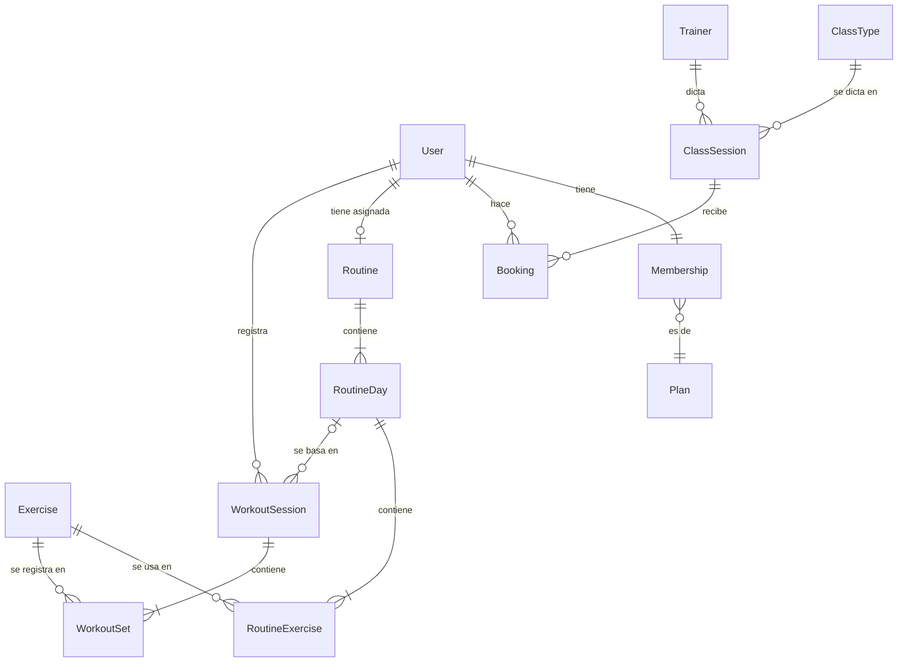

# 01 · Modelo de datos

> Define las entidades, sus campos, relaciones y reglas de negocio. Es la fuente de verdad para los schemas Zod de `src/domain/` y, más adelante, para la base de datos del backend.

## Convenciones

- **IDs:** `string` (UUID en el backend; en el mock pueden ser legibles, como `"class-1"`).
- **Fechas y horas:** `string` en ISO 8601 con zona horaria (`"2026-11-03T18:00:00-03:00"`). Solo fecha: `"2026-11-03"`.
- **Zona horaria de referencia:** `America/Argentina/Buenos_Aires`.
- **Pesos:** en kg, `number` con hasta 1 decimal. **Distancias/duración:** segundos y metros.
- **Enums:** strings en minúscula con guion bajo (`"no_show"`).
- **Nombres de campos:** camelCase, en inglés.
- **Campos derivados** (marcados con *) no se guardan: se calculan en `src/domain/`. En el mock pueden venir precalculados solo si se indica.

## Diagrama



---

## Usuarios y membresía

### User
| Campo | Tipo | Notas |
|---|---|---|
| id | string | |
| firstName | string | 1–50 caracteres |
| lastName | string | 1–50 caracteres |
| email | string | único, formato email |
| avatarUrl | string \| null | |
| weeklyGoal | number | entrenamientos por semana, 1–7. Default 3 |
| createdAt | string | ISO |

### Plan
| Campo | Tipo | Notas |
|---|---|---|
| id | string | |
| name | string | ej. "Pase libre", "3 veces por semana" |
| price | number | en ARS |
| weeklyClassLimit | number \| null | `null` = sin límite de reservas |

### Membership
| Campo | Tipo | Notas |
|---|---|---|
| id | string | |
| userId | string | un socio tiene como máximo una membresía vigente; puede no tener ninguna |
| planId | string | |
| startDate | string | fecha |
| endDate | string | fecha de vencimiento de la cuota |
| status* | `"active" \| "expiring" \| "expired"` | derivado, ver reglas |
| daysLeft* | number | derivado: días hasta `endDate` (negativo si venció) |

**Reglas**
- `expired` si hoy > `endDate`.
- `expiring` si faltan 5 días o menos (inclusive) para `endDate`.
- `active` en cualquier otro caso.
- El registro en la app crea solo el `User`, sin membresía. La membresía la da de alta el gimnasio (en recepción). Mientras no tenga, el socio ve "Sin membresía activa" y no puede reservar.

---

## Clases y reservas

### ClassType
Tipo de clase (catálogo).
| Campo | Tipo | Notas |
|---|---|---|
| id | string | |
| name | string | ej. "Funcional", "Spinning", "Yoga" |
| description | string | |
| durationMinutes | number | |
| intensity | `"low" \| "medium" \| "high"` | |
| color | `"accentOrange" \| "accentBlue" \| "accentGreen" \| "accentPurple" \| "accentPink" \| "accentTeal"` | token de acento del theme, no un hex. Cada uno tiene valor para modo claro y oscuro |

### Trainer
| Campo | Tipo | Notas |
|---|---|---|
| id | string | |
| firstName | string | |
| lastName | string | |
| avatarUrl | string \| null | |

### ClassSession
Una clase concreta en una fecha y hora.
| Campo | Tipo | Notas |
|---|---|---|
| id | string | |
| classTypeId | string | |
| trainerId | string | |
| startsAt | string | ISO |
| capacity | number | cupo total, > 0 |
| bookedCount | number | reservas confirmadas. Lo calcula el backend; el mock lo trae precalculado |
| spotsLeft* | number | `capacity - bookedCount`, nunca menor que 0 |
| isFull* | boolean | `spotsLeft === 0` |
| hasStarted* | boolean | ahora ≥ `startsAt` |

### Booking
| Campo | Tipo | Notas |
|---|---|---|
| id | string | |
| userId | string | |
| classSessionId | string | |
| status | `"confirmed" \| "cancelled" \| "attended" \| "no_show"` | |
| createdAt | string | ISO |
| cancelledAt | string \| null | ISO |

**Reglas de reserva**
1. Solo se puede reservar si el socio **tiene** membresía y **no** está `expired`.
2. No se puede reservar una clase llena (`isFull`) ni una que ya empezó (`hasStarted`).
3. Un socio no puede tener dos reservas `confirmed` para la misma `ClassSession`.
4. Un socio no puede tener dos reservas `confirmed` que se superpongan en horario.
5. Si el plan tiene `weeklyClassLimit`, no se puede superar esa cantidad de reservas `confirmed` + `attended` en la semana (lunes a domingo) de la clase.
6. Se puede cancelar hasta **2 horas antes** de `startsAt`. Después, el botón de cancelar no aparece.
7. Cancelar cambia `status` a `cancelled` y completa `cancelledAt`; no se borra el registro.

> En el backend, las reglas 2 a 5 se validan del lado del servidor y la regla 2 con control de concurrencia. En el front se validan para la UI (deshabilitar botones, mostrar motivo), pero el front no es la fuente de verdad.

**Motivos para mostrar en la UI** cuando no se puede reservar (enum `BookingBlockReason`):
`"no_membership" | "membership_expired" | "class_full" | "class_started" | "already_booked" | "schedule_overlap" | "weekly_limit_reached"`

Si se bloquea por varios motivos, se muestra uno solo, con esta prioridad: `no_membership`, `membership_expired`, `class_started`, `class_full`, `already_booked`, `schedule_overlap`, `weekly_limit_reached`.

---

## Ejercicios y rutinas

### Exercise
Catálogo de ejercicios.
| Campo | Tipo | Notas |
|---|---|---|
| id | string | |
| name | string | ej. "Sentadilla con barra" |
| muscleGroup | `"chest" \| "back" \| "legs" \| "shoulders" \| "arms" \| "core" \| "full_body"` | |
| equipment | `"barbell" \| "dumbbell" \| "machine" \| "cable" \| "bodyweight" \| "kettlebell" \| "other"` | |
| trackingType | `"weight_reps" \| "reps" \| "time"` | define qué campos se cargan en cada serie |
| instructions | string \| null | descripción paso a paso en texto plano (sin HTML) |
| imageUrl | string \| null | imagen principal; `null` si la fuente no tiene |
| imageAuthor | string \| null | autor de la imagen, para la atribución |
| imageLicense | string \| null | ej. `"CC-BY-SA 4.0"` |
| source | `"wger" \| "custom"` | origen del ejercicio |
| sourceId | string \| null | id en la fuente externa, para poder reimportar sin duplicar |

**Reglas de imagen**
- Si `imageUrl` es `null`, la app muestra un placeholder con el ícono del `muscleGroup`.
- Si hay `imageAuthor`, la pantalla de detalle del ejercicio muestra la atribución ("Imagen: {imageAuthor} · {imageLicense}").
- Las imágenes se muestran con `expo-image` (caché, placeholder mientras carga y soporte de GIF).

### Routine
Rutina asignada por el entrenador. Un socio tiene como máximo una activa.
| Campo | Tipo | Notas |
|---|---|---|
| id | string | |
| userId | string | |
| trainerId | string | |
| name | string | ej. "Hipertrofia – Bloque 1" |
| startDate | string | fecha |
| endDate | string \| null | fecha |
| isActive | boolean | |

### RoutineDay
| Campo | Tipo | Notas |
|---|---|---|
| id | string | |
| routineId | string | |
| order | number | 1, 2, 3… |
| name | string | ej. "Día A – Tren inferior" |

### RoutineExercise
Ejercicio planificado dentro de un día.
| Campo | Tipo | Notas |
|---|---|---|
| id | string | |
| routineDayId | string | |
| exerciseId | string | |
| order | number | |
| targetSets | number | > 0 |
| targetReps | string | admite rangos: `"8"`, `"8-10"`, `"AMRAP"` |
| targetWeightKg | number \| null | sugerido; `null` si es libre |
| targetSeconds | number \| null | solo para `trackingType: "time"` |
| restSeconds | number | default 90 |
| notes | string \| null | indicaciones del entrenador |

---

## Registro de entrenamientos

### WorkoutSession
Un entrenamiento realizado por el socio.
| Campo | Tipo | Notas |
|---|---|---|
| id | string | |
| userId | string | |
| routineDayId | string \| null | `null` si es un entrenamiento libre |
| startedAt | string | ISO |
| finishedAt | string \| null | `null` mientras está en curso |
| notes | string \| null | |
| durationSeconds* | number \| null | `finishedAt - startedAt` |
| totalVolumeKg* | number | suma de `weightKg × reps` de las series completadas |

**Reglas**
- Solo puede haber **una** `WorkoutSession` en curso (`finishedAt === null`) por usuario.
- La sesión en curso vive **solo en el celular** (store persistido localmente) y la regla anterior se valida ahí. No se envía al servidor hasta finalizar; así se puede entrenar sin conexión.
- Al finalizar, la sesión y sus series se envían al servidor ya con `finishedAt`. En el servidor, por lo tanto, todas las `WorkoutSession` están finalizadas.
- Una sesión sin ninguna serie completada no se guarda al finalizar (se descarta localmente, sin llamar a la API).

### WorkoutSet
| Campo | Tipo | Notas |
|---|---|---|
| id | string | |
| workoutSessionId | string | |
| exerciseId | string | |
| order | number | orden de la serie dentro del ejercicio |
| weightKg | number \| null | requerido si `trackingType = "weight_reps"`, ≥ 0 |
| reps | number \| null | requerido si `trackingType` es `"weight_reps"` o `"reps"`, > 0 |
| seconds | number \| null | requerido si `trackingType = "time"`, > 0 |
| completed | boolean | solo las completadas cuentan para estadísticas |
| completedAt | string \| null | ISO |

---

## Progreso (todo derivado)

No hay colecciones de progreso: todo se calcula en `src/domain/` a partir de `WorkoutSet` y `WorkoutSession`.

### 1RM estimado
Fórmula de Epley: `1RM = weightKg × (1 + reps / 30)`.
- Si `reps === 1`, el 1RM es el propio `weightKg`.
- Solo para series completadas de ejercicios `weight_reps` con `reps` entre 1 y 12. Fuera de ese rango no se estima (la fórmula pierde precisión).
- Se redondea a 0,5 kg.

### PersonalRecord*
Por ejercicio, se calculan:
| Campo | Tipo | Notas |
|---|---|---|
| exerciseId | string | |
| maxWeightKg | number \| null | mayor peso levantado en una serie completada |
| bestEstimated1RmKg | number \| null | mayor 1RM estimado |
| maxReps | number \| null | más repeticiones en una serie (útil para `reps`) |
| maxSeconds | number \| null | mayor duración en una serie (útil para `time`) |
| achievedAt | string | `completedAt` de la serie que estableció el récord principal: `bestEstimated1RmKg`; si no hay, `maxReps`; si no hay, `maxSeconds`. Ante un empate, la primera serie en lograrlo |

Solo se calcula el récord de un ejercicio que tenga al menos una serie completada con algún valor.

Una serie es **nuevo récord** si supera estrictamente el valor previo. Un empate no cuenta como récord. Se comparan las métricas principales según los datos de la serie:
- con peso y reps → `maxWeightKg` o `bestEstimated1RmKg`
- solo reps → `maxReps`
- solo segundos → `maxSeconds`

Si no hay valor previo para esa métrica (primera vez que se hace el ejercicio), no cuenta como récord.

### WeeklyStreak*
- La semana va de lunes a domingo.
- Una semana se **cumple** si la cantidad de días distintos con actividad (una `WorkoutSession` finalizada o un `Booking` con `status = "attended"`) es ≥ `user.weeklyGoal`.
- El día de una actividad es la fecha en Buenos Aires de `startedAt` (entrenamiento, aunque termine pasada la medianoche) o del `startsAt` de la clase (reserva).
- La **racha** es la cantidad de semanas consecutivas cumplidas, contando hacia atrás desde la semana anterior a la actual.
- Si la semana actual ya se cumplió, suma 1. Si todavía no se cumplió, no corta la racha (la semana sigue en curso).

---

## Fuente de datos de ejercicios (wger)

El catálogo de `Exercise` se importa de la API pública de **wger** (`https://wger.de/api/v2/`), que no requiere autenticación para ejercicios e imágenes. El resto de las entidades son datos propios del gimnasio y no vienen de fuentes externas.

### Principios
- **La app nunca consulta wger en vivo.** Los datos se importan con un script y se guardan en `mock/db.json` (y más adelante en la base del backend).
- **El modelo es nuestro.** El script es un adaptador: convierte el formato de wger a nuestro `Exercise`. Si se cambia de fuente, solo cambia el script.
- **Reimportar es idempotente:** se usa `sourceId` para actualizar en lugar de duplicar. Los ejercicios con `source: "custom"` no se tocan.

### Script `scripts/import-exercises.ts`
1. Traer ejercicios con `exerciseinfo`, solo los aprobados (`status=2`), paginando hasta el final.
2. Tomar nombre e instrucciones de la traducción en **español**; si no existe, usar la de **inglés**. Si no hay ninguna de las dos, descartar el ejercicio.
3. Limpiar el HTML de las instrucciones y dejar texto plano.
4. Elegir la imagen prefiriendo fotos reales (wger marca las generadas con IA con `is_ai_generated`), en este orden: principal (`is_main`) no IA → primera no IA → principal IA → primera IA. Si no hay ninguna, `imageUrl: null`. Guardar autor y licencia de la imagen:
   - si la imagen no tiene autor, `imageAuthor: "Comunidad de wger"`, para que la atribución siempre se muestre (la mayoría son CC-BY-SA);
   - la licencia se guarda con su nombre corto (`"CC-BY-SA 4"`, `"CC-BY-SA 3"`…); si el id de licencia es desconocido, `null`.
5. Mapear categorías y equipamiento de wger a nuestros enums (tabla de mapeo en `scripts/wger-mapping.ts`). Lo que no tenga equivalente va a `"other"` (equipamiento) o se descarta (grupo muscular), y se informa en la salida del script.
   - La categoría **Cardio** va a `"full_body"`.
   - Una lista de equipamiento **vacía** significa "desconocido", no "sin equipamiento": va a `"other"`. Solo "none (bodyweight exercise)" y "Pull-up bar" van a `"bodyweight"`.
   - wger no tiene equipamiento "máquina": si el nombre contiene "máquina" o "machine", el equipamiento es `"machine"`.
   - Si hay varios equipamientos, gana el primero en este orden: barra, mancuerna, kettlebell, polea, máquina, otro, peso corporal.
6. Inferir `trackingType` aplicando estas reglas **en orden** (gana la primera que se cumple):
   1. el ejercicio está en la lista de excepciones de `scripts/wger-mapping.ts` → el valor de la lista
   2. nombre (en español o inglés) que contenga "plank", "plancha", "hold" o "isométric" (sin distinguir mayúsculas ni tildes) → `"time"`
   3. categoría Cardio → `"time"`
   4. equipamiento barra, mancuerna, máquina, polea o kettlebell → `"weight_reps"`
   5. cualquier otro caso (peso corporal u `"other"`) → `"reps"`

   Ejemplo: una plancha sin equipamiento cumple las reglas 2 y 5; gana la 2 → `"time"`.
7. Escribir el resultado en la colección `exercises` de `mock/db.json` sin pisar las demás colecciones.
8. Al final, mostrar un resumen: importados, actualizados, descartados (con motivo) y sin imagen.

### Tests
La lógica de mapeo (`mapWgerExercise`, `inferTrackingType`, `pickMainImage`, `stripHtml`) va en funciones puras con tests unitarios usando respuestas de wger guardadas como fixtures en `scripts/__fixtures__/`. Los tests no llaman a la red.

### Atribución
- La pantalla de detalle de cada ejercicio muestra el autor y la licencia de la imagen.
- El README y la pantalla "Acerca de" mencionan a wger como fuente del catálogo de ejercicios, con enlace.

---

## API mock (json-server)

Colecciones planas en `mock/db.json`, relacionadas por id (sin objetos anidados):

```
users, plans, memberships, classTypes, trainers, classSessions,
bookings, exercises, routines, routineDays, routineExercises,
workoutSessions, workoutSets
```

- Usuario logueado de prueba: `user-1`.
- **Login mock:** `User` no tiene contraseña. El formulario pide email y contraseña (validados con Zod), pero el mock solo busca el usuario por email; cualquier contraseña válida sirve. La contraseña no se guarda en el mock ni se agrega al modelo; la valida recién el backend real (Fase 9).
- El seed incluye un usuario sin membresía para probar el estado "Sin membresía activa".
- Los datos deben cubrir los casos borde de las reglas: una clase llena, una clase que ya empezó, una membresía por vencer, una semana con racha cortada, ejercicios de los tres `trackingType` y al menos un récord personal en el historial.
- La colección `exercises` la genera `scripts/import-exercises.ts`; las rutinas y entrenamientos del mock referencian ejercicios importados, incluyendo al menos uno sin imagen para probar el placeholder.
- Las fechas de clases se generan relativas a "hoy" con un script (`mock/seed.ts`) para que el mock no quede viejo.
- json-server no valida reglas de negocio: en esta etapa, las reglas de reserva se aplican en el front (`src/domain/bookingRules.ts`) y quedan cubiertas por tests.

## Implementación en el front

- Cada entidad tiene su schema Zod en `src/domain/<entidad>.ts` y su tipo con `z.infer`.
- Las respuestas de la API se validan con el schema al llegar (en `src/api/`), así un cambio en el backend falla de forma clara.
- Los campos derivados se calculan con funciones puras, por ejemplo `getMembershipStatus(membership, today)`, `canBookClass(...)`, `estimate1Rm(weightKg, reps)`, `getWeeklyStreak(...)`. Todas reciben la fecha actual como parámetro para que se puedan testear.
